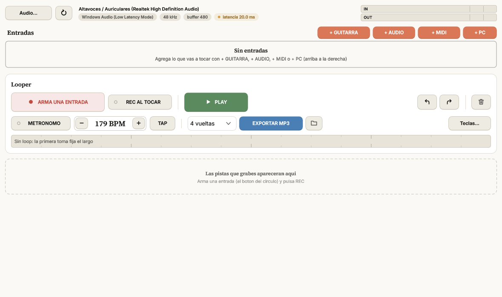

# AmpIA

Looper multipista para tocar en vivo en Windows. Carga amplificadores y efectos **VST3** (AmpliTube, Guitar Rig 7...) y graba varias entradas a la vez, cada una en su pista. Hecho en C++ con [JUCE](https://juce.com).



## Qué hace

- **Entradas**: arranca vacía y agregas solo lo que vas a usar.
  - **+ GUITARRA**: entrada de audio con su amplificador.
  - **+ AUDIO**: voz o micrófono, con un efecto. Trae voces propias: Chester, Cobain y Natural.
  - **+ MIDI**: teclado o batería con un instrumento.
  - **+ PC**: lo que suena en Windows.
- **Looper**: la primera toma fija el largo y las siguientes van a pistas nuevas. Tiene deshacer y rehacer, metrónomo, y volumen, paneo y mute por pista. Exporta a MP3.
- **SEPARAR**: saca la batería o el bajo de una pista con Demucs.
- **Presets de AmpliTube 5**: los favoritos se cargan con Ctrl+1-9.
- **Teclado y Launchkey MK3**: las teclas se pueden reasignar (botón *Teclas...*). Si hay un Launchkey MK3, se usa en modo DAW.
- **Interfaz**: modo claro, con un color por tipo de botón: rojo para grabar, verde para sonar, azul para exportar, morado para el tempo y naranja para agregar entradas. Los atajos aparecen en el tooltip de cada botón. Las fuentes (Inter y Source Serif 4, licencia OFL) van dentro del ejecutable.

## Compilar

Requisitos:
- Windows 10/11 de 64 bits.
- **Visual Studio 2022** o *Build Tools 2022*, con **"Desarrollo para el escritorio con C++"**.
- Git.

Clona el repo en una ruta corta (por ejemplo `C:\dev\ampia`): con rutas muy largas MSVC falla. Después:

```bat
build.bat
```

La primera vez descarga JUCE 8.0.4. El ejecutable queda en `build\AmpBox_artefacts\Release\AmpBox.exe`. `ABRIR-AMPBOX.bat` compila si hace falta y abre la app.

### SDKs de Steinberg (opcionales, no incluidos)

No se pueden redistribuir. Sin ellos la app compila igual, con menos funciones:

| Carpeta | Para qué | Sin ella | Qué copiar |
|---|---|---|---|
| `asiosdk/` | ASIO: latencia baja con una interfaz de audio | Solo audio de Windows | Los `.h` de `common/` del *ASIO SDK* (steinberg.net) |
| `vst2sdk/` | Plugins VST2 (Guitar Rig 5) | Solo VST3 | `pluginterfaces/vst2.x/aeffect.h` y `aeffectx.h` de un VST SDK 3.6.x |

Si agregas alguna carpeta después, borra `build/` y vuelve a compilar.

## Extras

- **SEPARAR**: doble clic en `INSTALAR-SEPARAR.bat`. Instala Demucs en el Python de la PC (~2 GB) y baja el modelo.
- **MP3**: necesita `ffmpeg` (`winget install ffmpeg`). Sin ffmpeg, exporta en WAV.
- **Batería AmpBox**: usa los sonidos de Ableton Live si está instalado.

## Configuración

Todo lo de cada PC queda en `%APPDATA%\AmpBox\`, fuera del repo: entradas, teclas, interfaz de audio y log.

- **Interfaz preferida**: si la que figura en `preferredInterface` (en `ampbox.xml`) está conectada, se usa esa. Si no, se usa otra ASIO. Si no hay ninguna ASIO, se usa el audio de Windows.
- **Arranque**: los plugins grandes como AmpliTube tardan hasta un minuto en cargar. La ventana avisa cuál está cargando.
